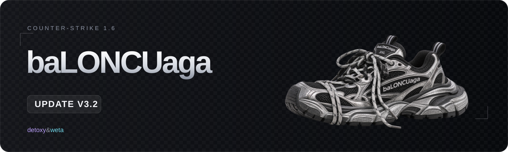

# baLONCUaga — Update V3

HUD для CS 1.6 Steam Legacy x86. Windows, OpenGL. Интерфейс на русском и английском.

[Скачать для чистой CS](https://github.com/fr3cy/baloncuaga-hud-cs1.6/releases/download/v3/BALONCUAGA_v3_FULL.zip) · [Обновить ASI](https://github.com/fr3cy/baloncuaga-hud-cs1.6/releases/download/v3/CS16Customizer.asi) · [Исходники](./source)

## Добавлено

- **Серверы.** История и избранное Steam, названия и IP, поиск, переключение, удаление и отмена удаления.
- **Стрейфы.** Шесть компактных прозрачных стилей справа. Настройки: HUD → FOG → Стрейфы.
- **CS Fix (Garey).** Ползунок fps_visual от 20 до 1000, стандарт — 100. Компонент встроен в ASI.
- **БРАТУХА.** Собеседник во вкладке чата: разговоры, шутки и подколы.

## Исправлено

- Мигание галочек и выделения серверов. Выбор сохраняется при обновлении и фильтрации списка.
- FOG снова считается локально и показывает скорость отрыва и прирост. Считывание FOG с сервера убрано.
- Устранён найденный в дампах сбой оконного обработчика после выгрузки HUD.
- Добавлены проверки повреждённых данных серверного HUD. Исправлено скрытие распознанной серверной статы при включении своей.
- Insert открывает меню в главном экране и поверх обычной паузы. Escape сохраняет штатное поведение.
- Для чистой CS используется dinput.dll. Главное меню и TAB оставлены штатными, фоны BALONCUAGA убраны.
- Отключены запись файловых логов HUD и сохранение переписок; пути сборки очищены.

Модели оружия и игроков, прицел, FOV, радар, чат и радио, скайбоксы, Showkeys, тренажёр колеса, цвет дыма и флешки, конфиги сохранены.

## Установка

1. Закрой CS.
2. Распакуй FULL рядом с hl.exe: **CS16Customizer.asi, dinput.dll, global.ini**.
3. Оставь один загрузчик и одну копию HUD. Отключи старые ASI из scripts и CS16Phone-HONOR200.asi, если они остались.
4. Запусти CS в OpenGL. Меню — **Insert**. Если появится запрос перезапуска после установки ресурсов, перезапусти игру.

Для обновления рабочей установки достаточно заменить CS16Customizer.asi. Нужные папки создаются автоматически.

Свои MDL: cstrike/models/customizer/knife, he, flash, smoke. Затем «Обновить список» → «Применить».

F11 выгружает HUD. Встроенный CS Fix работает до закрытия игры. Активация не требуется.

## Исходники

Код — [source](./source), зависимости — [third_party](./third_party), сборка — [BUILD_RU.txt](./BUILD_RU.txt). Для игры скачай FULL из Releases.

Сборка и автономные проверки пройдены. Подключение к реальному серверу в финальной сборке не проверялось.

## Авторы

[fr3cy](https://github.com/fr3cy) · [wetalik001](https://github.com/wetalik001)

CS Fix: [Garey27 / CS_Patches](https://github.com/Garey27/CS_Patches). Лицензии компонентов — [licenses](./licenses).
