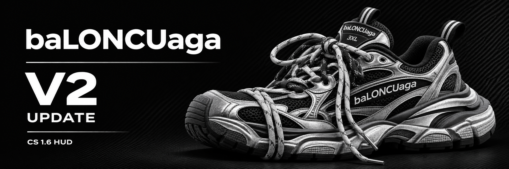

# baLONCUaga V2 — UPDATE

HUD для CS 1.6 Steam Legacy x86, Windows и OpenGL. Русский и английский интерфейс.

[Скачать для чистой CS](https://github.com/fr3cy/baloncuaga-hud-cs1.6/releases/download/v2/BALONCUAGA_v2_FULL.zip) · [Обновить ASI](https://github.com/fr3cy/baloncuaga-hud-cs1.6/releases/download/v2/CS16Customizer.asi) · [Исходники](./source)

## Что нового в V2

- **Автоустановка.** Модели и ресурсы оформления встроены в ASI. При первом запуске создаются нужные папки и устанавливаются 120 файлов. Заменяемые ресурсы сохраняются в резервную копию; конфиги и свои модели в `customizer` не заменяются.
- **Карбон и 3XL.** Чёрно-белое меню с анимациями открытия и закрытия, оформление главного экрана и штатных окон игры.
- **Шесть скайбоксов.** Солнечный день, закат, пасмурное небо, сияние, космос и ночной вариант с кроссовком 3XL. Небо и превью хранятся внутри ASI.
- **Одежда команд.** Комплекты для всех КТ и ТТ, выбор персонажа и вращаемый 3D-предпросмотр. Сетка моделей облегчена, команды отрисовки сгруппированы; текстуры сохранены.
- **Масштаб и шрифты.** Меню, чат и HUD учитывают разрешение экрана. Исправлены координаты мыши и выход спидометра/FOG за границы кадра.
- **Игровой HUD.** Новое оформление здоровья, брони, патронов, денег и таймера. TAB возвращён к штатному виду CS 1.6, без стеклянного фона и замены шрифтов.

Остаются смена моделей оружия в игре, FOV, настройка прицела, текстурный 2D/3D-радар, чат игроков/сервера/радио с историей, спидометр и FOG, Showkeys, тренажёр колеса, цвет дыма и флешки, сохранение настроек и профилей.

## Установка

1. Закрой CS и сохрани старый ASI вне папки игры.
2. Для чистой игры распакуй **FULL** рядом с `hl.exe`: внутри `CS16Customizer.asi`, `version.dll` и `global.ini`. Если загрузчик уже установлен, замени только ASI. Оставь одну копию плагина; прежнюю из `scripts` убери.
3. Запусти CS. После сообщения об установке файлов **перезапусти игру один раз**. Затем меню открывается на **Insert**.

Свои MDL: `cstrike/models/customizer/knife`, `he`, `flash`, `smoke`. В меню нажми «Обновить список», выбери модель и нажми «Применить». Файлы-компаньоны должны лежать рядом с моделью.

F11 выгружает функционал ASI. Установленные файлы оформления остаются на диске; резервные копии находятся в `.baloncuaga-install/backups`. Активация не требуется.

## Исходники

Код — в [source](./source), зависимости — в [third_party](./third_party). Сборка описана в [BUILD_RU.txt](./BUILD_RU.txt). Для игры исходники не нужны.

Модели, установщик и интерфейс проверены на автономных стендах. Финальная V2 не проверялась на живом сервере; стабильные 100 FPS не заявляются. Подробности — [CHECKS_RU.txt](./CHECKS_RU.txt).

## Contributors

Проект сделали вместе: [fr3cy](https://github.com/fr3cy) и [wetalik001](https://github.com/wetalik001).
